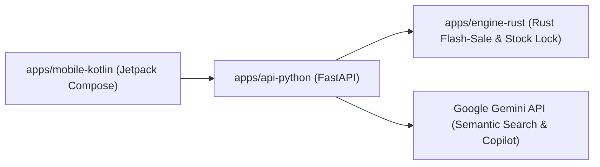

# 🏗️ Architecture — GE Shop Monorepo (`ge-shop`)

## 1. Monorepo Layout
```text
ge-shop/
├── AGENTS.md
├── docs/
│   ├── foundation/
│   ├── planning/roadmap.md
│   └── specs/
└── apps/
    ├── api-python/          # FastAPI + Pydantic v2 + SQLAlchemy + Pytest (uv)
    │   ├── app/modules/{auth,shops,catalog,cart,vouchers,orders,escrow,ai_search}/
    │   └── tests/
    ├── engine-rust/         # Rust + Axum + Tokio (Flash-Sale & Atomic Stock Lock Engine)
    │   ├── Cargo.toml
    │   └── src/{domain,handlers,state}.rs
    └── mobile-kotlin/       # Kotlin 2.x + Jetpack Compose + Pure-Kotlin Domain
        ├── build.gradle.kts
        └── app/src/main/java/com/jutsuworks/geshop/{domain,data,ui}/
```

## 2. Service Interaction Diagram
