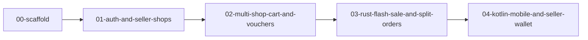

# 🗺️ Project Roadmap — GE Shop (`ge-shop` · Spec Track B Marketplace)

## Feature Specs Registry & Dependency Matrix

| ID | Feature Slug | Wave | Depends On | Touches (Isolation Zone) | Spec Path | Status |
|----|--------------|------|------------|--------------------------|-----------|--------|
| `00` | `00-scaffold` | `Wave 0` | None | `apps/api-python/, apps/engine-rust/, apps/mobile-kotlin/` | [`docs/specs/00-scaffold/`](../specs/00-scaffold/tasks.md) | `[x]` |
| `01` | `01-auth-and-seller-shops` | `Wave 1` | `00` | `apps/api-python/app/modules/{auth,shops,catalog,ai_search}/` | [`docs/specs/01-auth-and-seller-shops/`](../specs/01-auth-and-seller-shops/tasks.md) | `[ ]` |
| `02` | `02-multi-shop-cart-and-vouchers` | `Wave 2` | `01` | `apps/api-python/app/modules/{cart,vouchers}/` | [`docs/specs/02-multi-shop-cart-and-vouchers/`](../specs/02-multi-shop-cart-and-vouchers/tasks.md) | `[ ]` |
| `03` | `03-rust-flash-sale-and-split-orders` | `Wave 3` | `02` | `apps/engine-rust/, apps/api-python/app/modules/{orders,escrow}/` | [`docs/specs/03-rust-flash-sale-and-split-orders/`](../specs/03-rust-flash-sale-and-split-orders/tasks.md) | `[ ]` |
| `04` | `04-kotlin-mobile-and-seller-wallet` | `Wave 4` | `03` | `apps/mobile-kotlin/, apps/api-python/app/modules/escrow/` | [`docs/specs/04-kotlin-mobile-and-seller-wallet/`](../specs/04-kotlin-mobile-and-seller-wallet/tasks.md) | `[ ]` |

