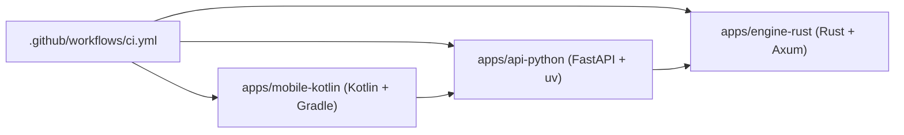

# Technical Design: `00-scaffold` — GE Shop Polyglot Monorepo Scaffold

## 1. Architecture Flow

## 2. File Placement
- `[NEW]` `.gitignore` — Root ignore rules for Python (`.venv/`, `__pycache__/`), Rust (`target/`), and Kotlin/Gradle (`.gradle/`, `build/`).
- `[NEW]` `.github/workflows/ci.yml` — Multi-job CI workflow verifying Python (`ruff` + `pytest`), Rust (`cargo check` + `cargo test`), and Kotlin (`./gradlew testDebugUnitTest`).
- `[NEW]` `apps/api-python/pyproject.toml` — `uv` project configuration with FastAPI, Pydantic v2, SQLAlchemy 2.0, `httpx`, `pytest`, and `ruff`.
- `[NEW]` `apps/api-python/app/main.py` — FastAPI app factory with lifespan, CORS, and `GET /health`.
- `[NEW]` `apps/api-python/app/core/config.py` — `pydantic-settings` configuration (`Settings`).
- `[NEW]` `apps/api-python/app/shared/money.py` — Pure integer-cent `MoneyCents` value object rejecting floats.
- `[NEW]` `apps/api-python/app/modules/{auth,shops,catalog,cart,vouchers,orders,escrow,ai_search}/__init__.py` — Domain module packages ready for Waves 1–4.
- `[NEW]` `apps/api-python/tests/test_health_and_money.py` — Unit & invariant tests for `/health` and `MoneyCents` (`Req 1.1`).
- `[NEW]` `apps/engine-rust/Cargo.toml` — Rust crate configuration (`axum`, `tokio`, `serde`, `serde_json`).
- `[NEW]` `apps/engine-rust/src/lib.rs`, `src/main.py`/`src/main.rs`, `src/domain.rs`, `src/state.rs`, `src/handlers.rs` — Pure Rust `Money` (`i64`) and atomic `StockPool` (`AtomicI64` CAS loop) plus Axum router and unit tests (`Req 1.2`).
- `[NEW]` `apps/mobile-kotlin/settings.gradle.kts`, `build.gradle.kts`, `gradle.properties`, `gradlew`, `gradlew.bat`, `gradle/wrapper/*` — Multi-module Gradle setup (`:core` pure Kotlin JVM + `:app` Android/JVM test harness with `testDebugUnitTest` alias and `checkMergedManifestPermissions` task).
- `[NEW]` `apps/mobile-kotlin/core/src/main/kotlin/com/jutsuworks/geshop/domain/model/{Money.kt,CartGroup.kt}` — Pure-Kotlin `Money` (`Long` cents) and `CartGroup` voucher clamping models (`Req 1.3`).
- `[NEW]` `apps/mobile-kotlin/core/src/test/kotlin/com/jutsuworks/geshop/domain/model/MoneyAndCartGroupTest.kt` — JUnit 5 invariant tests for `Money` and `CartGroup` (`Req 1.3`).

## 3. Data Models & Invariants
1. **Property 1 (Zero-Float Money Math):**
   - Python `MoneyCents(amount_cents: int)` rejects `float` inputs with `TypeError`/`ValidationError`.
   - Rust `Money(i64)` supports checked addition, subtraction, and clamped discount application.
   - Kotlin `Money(val cents: Long)` rejects negative subtotals when clamping discounts (`maxOf(0L, subtotal - discount)`).
2. **Property 2 (Atomic Non-Negative Stock Pool):**
   - Rust `StockPool::try_reserve(qty: i64)` uses an atomic compare-exchange loop so concurrent reservations never drop remaining stock below `0`.

## 4. Error Handling Matrix
| Scenario | Layer | Expected Behavior |
|----------|-------|-------------------|
| Float passed to `MoneyCents` | `apps/api-python` | Raises `TypeError` / Pydantic `ValidationError` |
| `StockPool::try_reserve(qty)` with `qty <= 0` or `qty > available` | `apps/engine-rust` | Returns `Err(StockError::InvalidQuantity)` or `Err(StockError::SoldOut)` without mutating stock |
| Shop voucher exceeds `CartGroup` subtotal | `apps/mobile-kotlin` | Clamps net subtotal to `Money(0L)` (never negative) |
