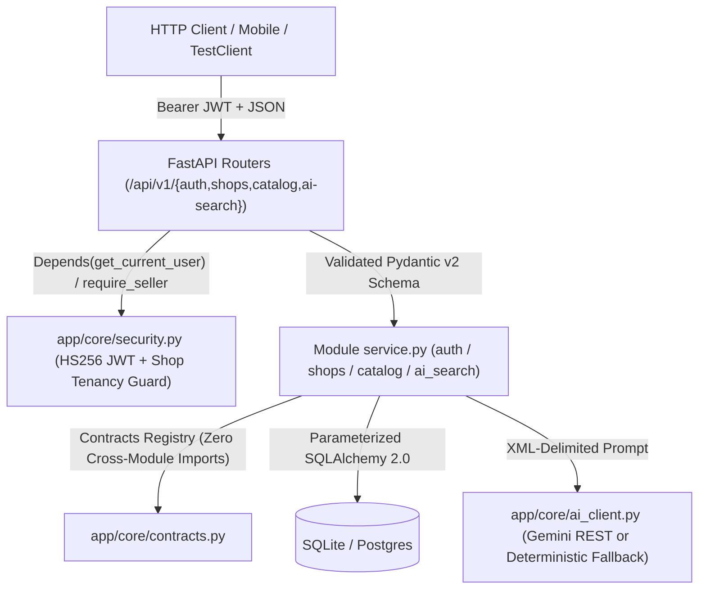

# 📐 Technical Design: Auth, Seller Shops, Catalog & Gemini Search (`01-auth-and-seller-shops`)

> **Feature Slug:** `01-auth-and-seller-shops` · **Requirements:** [`requirements.md`](./requirements.md)  
> **Visual Reference:** Backend API only (no `[FE]` UI in Wave 1)  
> **Blast Radius:** `🟡 CONTAINED` (Adds Wave 1 domain modules + core security/AI helpers in `apps/api-python/`)

---

## 1. Architecture & Data Flow

`apps/api-python/` follows Modular Domain Architecture (`app/modules/{auth,shops,catalog,ai_search}/`) with strict module isolation: no `app/modules/[a]/` file imports internals from `app/modules/[b]/`. Cross-module queries needed at login (`auth` -> user's `shop_id`) and semantic search (`ai_search` -> active catalog items) are bridged via typed callback registries in `app/core/contracts.py`, wired once inside `app/main.py`.

---

## 2. File Placement & Module Boundaries

| Action | Exact File Path | Layer | Responsibility | Validates |
| :--- | :--- | :--- | :--- | :--- |
| `[MODIFY]` | `apps/api-python/app/core/config.py` | `[BE]` Core | Add JWT expiration & Gemini settings | `Req 1.3, 4.1, 4.2` |
| `[MODIFY]` | `apps/api-python/app/shared/money.py` | `[BE]` Shared | Add `validate_exact_int_cents` / `StrictPositiveCents` validator rejecting floats & bools | `Req 3.2, 3.3` |
| `[NEW]` | `apps/api-python/app/core/security.py` | `[BE]` Core | PBKDF2 password hashing, HS256 JWT sign/verify, `AuthenticatedUser`, `get_current_user`, `require_seller`, `verify_shop_ownership` | `Req 1.1–1.4, 2.3, 3.1` |
| `[NEW]` | `apps/api-python/app/core/contracts.py` | `[BE]` Core | Cross-module protocol/registry (`ShopLookupFn`, `CatalogSearchFn`, `CatalogItemSummary`) wired in `app/main.py` | `Req 1.3, 4.1` |
| `[NEW]` | `apps/api-python/app/core/ai_client.py` | `[BE]` Core | Prompt builder (`<user_input>` XML guard), Gemini REST client via `httpx`, deterministic offline fallback | `Req 4.1–4.3` |
| `[NEW]` | `apps/api-python/app/modules/auth/{models,schemas,service,router}.py` | `[BE]` Auth | User registration, login, token refresh, `/me` | `Req 1.1–1.4` |
| `[NEW]` | `apps/api-python/app/modules/shops/{models,schemas,service,router}.py` | `[BE]` Shops | Seller shop onboarding, public read, owner-guarded update | `Req 2.1–2.3` |
| `[NEW]` | `apps/api-python/app/modules/catalog/{models,schemas,service,router}.py` | `[BE]` Catalog | Product & SKU CRUD with `shop_id` tenancy guard and `price_cents` int64 validation | `Req 3.1–3.4` |
| `[NEW]` | `apps/api-python/app/modules/ai_search/{schemas,service,router}.py` | `[BE]` AI Search | Semantic intent extraction, catalog ranking, integer `min_price_cents` response | `Req 4.1–4.3` |
| `[MODIFY]` | `apps/api-python/app/main.py` | `[BE]` App | Register DB models, wire `contracts` adapters, mount all 4 module routers | `Req 1.1–4.3` |
| `[NEW]` | `apps/api-python/tests/test_auth_shops_catalog.py` | `[BE]` Test | Unit & API integration tests covering happy paths, float rejection, and `403` cross-shop tenancy | `Req 1.1–3.4` |
| `[NEW]` | `apps/api-python/tests/evals/test_ai_search_eval.py` | `[BE]` Eval | Tier 1 deterministic prompt-injection/schema evals + Tier 2 `RUN_AI_EVALS=1` live evals | `Req 4.1–4.3` |

---

## 3. Data Models & API Contracts

### Database Entities (SQLAlchemy 2.0)

1. **`users`** (`app/modules/auth/models.py`):
   - `id` (`Integer`, PK), `email` (`String(255)`, unique, indexed), `password_hash` (`String(255)`), `full_name` (`String(120)`), `role` (`String(20)` — `buyer` | `seller` | `admin`), `is_active` (`Boolean`, default `True`), `created_at` (`DateTime(timezone=True)`).
2. **`shops`** (`app/modules/shops/models.py`):
   - `id` (`Integer`, PK), `owner_user_id` (`Integer`, unique, indexed), `name` (`String(120)`), `slug` (`String(120)`, unique, indexed), `description` (`String(500)`), `is_active` (`Boolean`, default `True`), `created_at` (`DateTime(timezone=True)`).
3. **`products`** (`app/modules/catalog/models.py`):
   - `id` (`Integer`, PK), `shop_id` (`Integer`, indexed), `title` (`String(200)`), `description` (`String(2000)`), `category` (`String(80)`, indexed), `is_active` (`Boolean`, default `True`), `created_at` (`DateTime(timezone=True)`).
4. **`product_skus`** (`app/modules/catalog/models.py`):
   - `id` (`Integer`, PK), `product_id` (`Integer`, FK `products.id` ondelete CASCADE, indexed), `shop_id` (`Integer`, indexed), `sku_code` (`String(80)`), `variant_name` (`String(120)`), `price_cents` (`BigInteger`, `> 0`), `stock_qty` (`Integer`, `>= 0`), `is_active` (`Boolean`, default `True`), `created_at` (`DateTime(timezone=True)`).
   - Unique constraint: `(shop_id, sku_code)`.

### API Endpoints

- `POST /api/v1/auth/register` (`201`) -> `{ "user": {...}, "access_token": "...", "token_type": "bearer" }`
- `POST /api/v1/auth/login` (`200`) -> `{ "user": {...}, "access_token": "...", "token_type": "bearer" }`
- `POST /api/v1/auth/refresh` (`200`, Bearer) -> `{ "user": {...}, "access_token": "...", "token_type": "bearer" }`
- `GET /api/v1/auth/me` (`200`, Bearer) -> `{ "user_id": 1, "email": "...", "role": "seller", "shop_id": 1 }`
- `POST /api/v1/shops` (`201`, Seller Bearer) -> `{ "id": 1, "owner_user_id": 1, "name": "...", "slug": "...", "description": "...", "is_active": true, "access_token": "..." }`
- `GET /api/v1/shops/{shop_id}` (`200`) -> `ShopResponse`
- `PATCH /api/v1/shops/{shop_id}` (`200`, Seller Owner Bearer) -> `ShopResponse`
- `POST /api/v1/catalog/shops/{shop_id}/products` (`201`, Seller Owner Bearer) -> `ProductResponse`
- `PATCH /api/v1/catalog/shops/{shop_id}/products/{product_id}` (`200`, Seller Owner Bearer) -> `ProductResponse`
- `POST /api/v1/catalog/shops/{shop_id}/products/{product_id}/skus` (`201`, Seller Owner Bearer) -> `ProductSKUResponse`
- `PATCH /api/v1/catalog/shops/{shop_id}/skus/{sku_id}` (`200`, Seller Owner Bearer) -> `ProductSKUResponse`
- `GET /api/v1/catalog/products` (`200`) -> `list[ProductResponse]`
- `GET /api/v1/catalog/products/{product_id}` (`200`) -> `ProductResponse`
- `POST /api/v1/ai-search/search` (`200`) -> `{ "query": "...", "provider": "google|offline-fallback", "intent": {...}, "results": [...] }`

---

## 4. Error Handling Matrix

| Category | Trigger | HTTP Status | DB Write? | Validates |
| :--- | :--- | :--- | :--- | :--- |
| `auth` | Missing/invalid/expired JWT or wrong login password | `401` | No | `Req 1.4` |
| `permission` | Buyer creates shop; user registers as `admin`; seller mutates another `shop_id` or unowned product/SKU | `403` | No | `Req 1.2, 2.2, 2.3, 3.1` |
| `conflict` | Duplicate email, second shop for same seller, duplicate shop `slug`, or duplicate `(shop_id, sku_code)` | `409` | No | `Req 1.2, 2.2` |
| `not_found` | Unknown `shop_id`, `product_id`, or `sku_id` | `404` | No | `Req 3.4` |
| `validation` | Float/bool/non-positive `price_cents`, negative `stock_qty`, short password, empty query | `422` | No | `Req 1.1, 3.3, 4.3` |

---

## 5. Correctness Properties & Verification Strategy

### Correctness Properties (Invariants)
- **Property 1 (Multi-Vendor Tenancy Isolation):** *For any* seller write endpoint (`shops` update, `catalog` product/SKU create or update), if `current_user.shop_id != target_shop_id` OR the target entity's `shop_id != target_shop_id`, the API SHALL return `403 FORBIDDEN` before any database mutation occurs. *(Validates: `Req 2.3, 3.1`)*
- **Property 2 (Zero-Float Money Math):** *For any* catalog SKU price input (`float`, `bool`, or `<= 0`), Pydantic v2 validation SHALL reject the payload with `422` without coercing floats (e.g. `19.0`) to `int`. *(Validates: `Req 3.2, 3.3`)*
- **Property 3 (Prompt Injection & Schema Safety):** *For any* buyer search query including adversarial instructions, the prompt builder SHALL enclose the truncated input inside `<user_input>...</user_input>` tags and return a valid `AISearchResponse` with integer `min_price_cents`. *(Validates: `Req 4.1–4.3`)*

### Verification Commands
- **Lint Check:** `cd apps/api-python && uv run ruff check .`
- **Full Test & AI Eval Suite:** `cd apps/api-python && uv run pytest`
